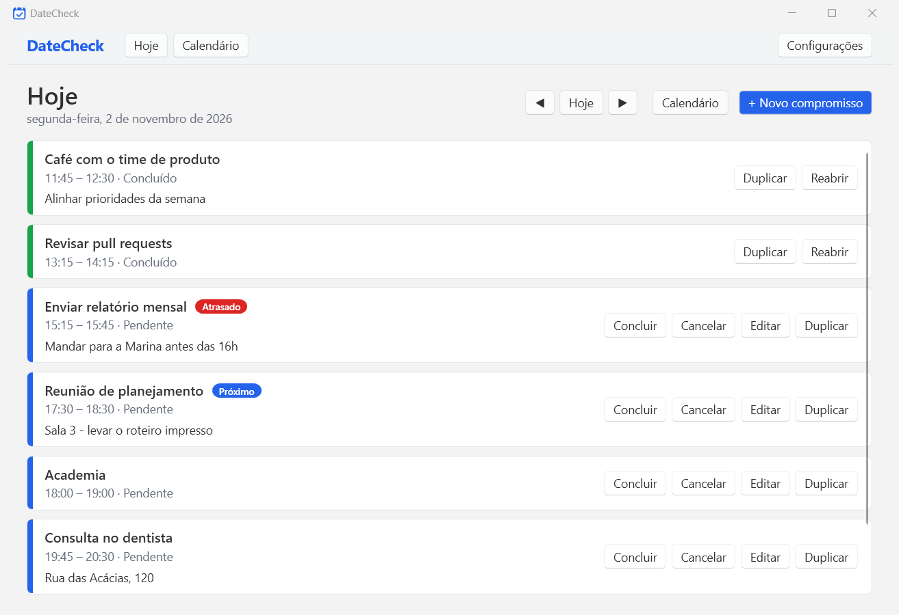
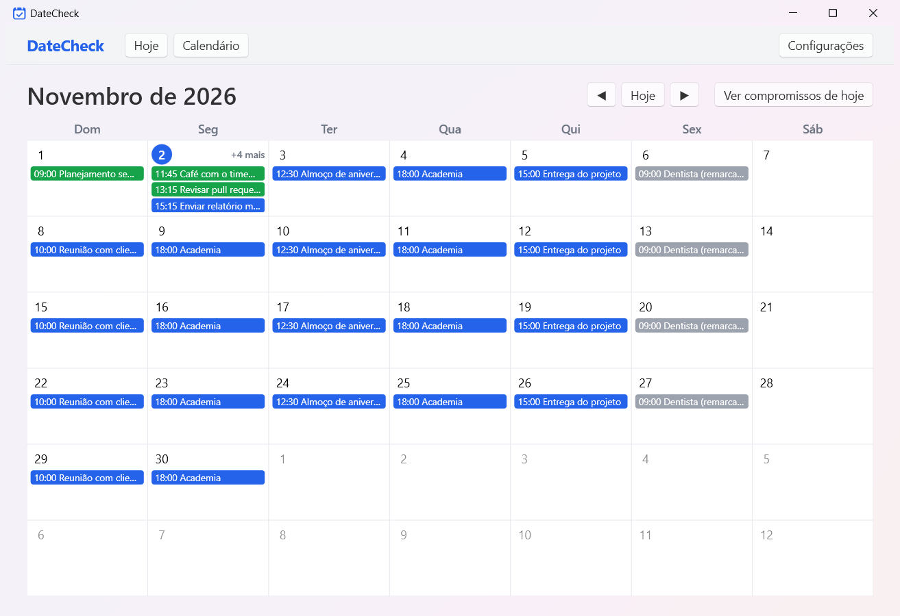
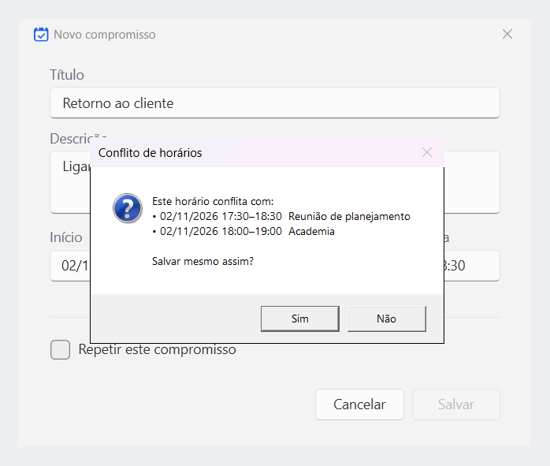
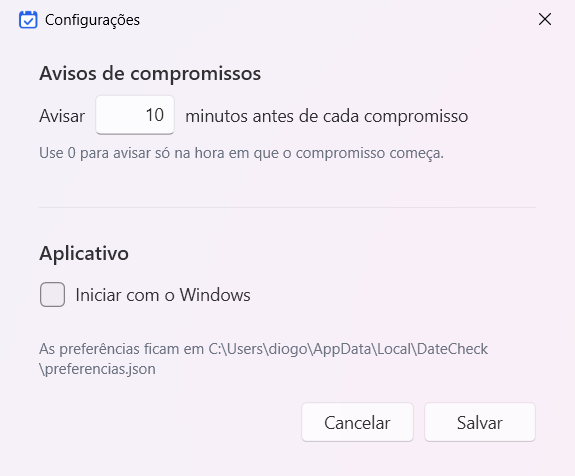
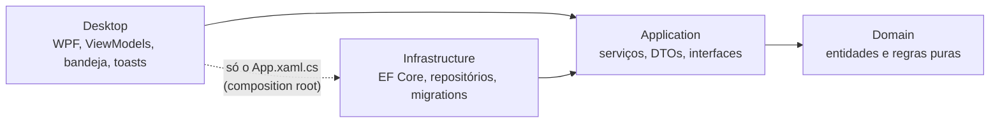

# DateCheckSistem

Agenda pessoal desktop para Windows, em estilo calendário. Abre junto com o sistema, mostra os compromissos do dia e avisa antes de cada um começar.



<table>
  <tr>
    <td></td>
    <td></td>
  </tr>
  <tr>
    <td align="center">Calendário mensal</td>
    <td align="center">Formulário com aviso de conflito</td>
  </tr>
</table>

<p align="center"></p>

> As capturas usam um banco de demonstração com dados fictícios (veja [`tools/capturas`](tools/capturas)).

## Funcionalidades

- **Hoje**: lista do dia com destaque para o **próximo** compromisso e para os **atrasados**; concluir, cancelar, reabrir, editar e duplicar. Atualiza sozinha a cada 30 s.
- **Calendário mensal**: navegação entre meses, cor por status (pendente, concluído, cancelado) e clique no dia para abri-lo na tela Hoje.
- **Criar e editar** compromissos, com **duplicar** para outra data e **repetir** (diário, semanal ou mensal, até uma data de fim de no máximo 1 ano).
- **Aviso de conflito** de horário ao salvar. O aviso não bloqueia: você decide se salva mesmo assim.
- **Iniciar com o Windows**, ligado e desligado dentro do app.
- **Ícone na bandeja**: fechar a janela só a esconde; "Sair" encerra de verdade.
- **Instância única**: abrir o app de novo traz a janela já aberta para a frente.
- **Notificações (toast)** alguns minutos antes de cada compromisso (padrão 10 min, configurável), sem repetir o mesmo aviso.
- Interface em pt-BR.

## Tecnologias

- C# / .NET 10, WPF com MVVM ([CommunityToolkit.Mvvm](https://github.com/CommunityToolkit/dotnet))
- SQL Server Express + Entity Framework Core 10 (Code First, migrations aplicadas na inicialização)
- `Microsoft.Extensions.Hosting` para injeção de dependência e serviços em segundo plano
- [Hardcodet.NotifyIcon.Wpf](https://github.com/hardcodet/wpf-notifyicon) (bandeja) e `AppNotificationManager` do Windows App SDK (toasts)
- xUnit (e `FakeTimeProvider`) para os testes

## Arquitetura

As dependências apontam para dentro: a regra de negócio não conhece banco nem interface.



| Camada | Responsabilidade |
|---|---|
| `DateCheck.Domain` | `Agendamento`, `StatusAgendamento` e as invariantes. Sem dependências externas. |
| `DateCheck.Application` | Casos de uso (criar, editar, duplicar, repetir, conflitos), DTOs e interfaces de repositório. |
| `DateCheck.Infrastructure` | `AppDbContext`, mapeamento por `IEntityTypeConfiguration<T>`, repositório e migrations. |
| `DateCheck.Desktop` | Views XAML, ViewModels, navegação, diálogos, bandeja, início com o Windows e notificações. |

ViewModels e Views só conversam com interfaces da Application. Apenas o `App.xaml.cs` referencia a Infrastructure, para montar o container.

### Principais decisões

- **Sem recorrência salva.** Cada agendamento é independente, com horário e status próprios. "Repetir" é só um atalho que cria cópias; o `SerieId` apenas agrupa as cópias criadas juntas. Assim, mudar ou cancelar um dia nunca afeta os outros e não existe regra de exceção a uma série.
- **Duplicar e Repetir criam cópias pendentes**, mantendo título, descrição e duração. Repetir exige data de fim (máximo de 1 ano); no mensal, o dia 31 cai no último dia dos meses mais curtos.
- **Conflitos não bloqueiam.** A regra é `inicioA < fimB && inicioB < fimA`, ignorando cancelados e o próprio compromisso na edição. O serviço devolve a lista e a tela pergunta se salva mesmo assim; ao repetir, a prévia mostra quais cópias conflitam.
- **Um contexto de banco por operação.** `AddDbContextFactory`: cada operação cria e descarta o seu `DbContext`, sem contexto vivo no app de longa duração.
- **Retry na inicialização.** `EnableRetryOnFailure` espera o SQL Server subir ao ligar o Windows; se mesmo assim falhar, um diálogo oferece "tentar novamente" ou "sair". O ícone da bandeja aparece antes do banco, com o balão "Iniciando…".
- **O domínio valida a si mesmo.** Setters privados e métodos como `Concluir()`, `Cancelar()`, `Reabrir()` e `Reagendar()` lançam `DomainException` quando uma invariante seria violada.
- **Tempo injetado.** `TimeProvider` no lugar de `DateTime.Now`, o que permite testar com `FakeTimeProvider` as regras de atraso, de próximo compromisso e de notificação.
- **Toast sem repetir.** O serviço de notificações (a cada 30 s) avisa só pendentes que começam dentro da antecedência, nunca os que já começaram (por exemplo, na volta da suspensão) e uma vez por par (Id, Início).
- **O registro é a fonte da verdade** para "Iniciar com o Windows" (`HKCU\...\Run`): o app não guarda uma cópia dessa opção. O caminho é reescrito a cada abertura se a opção estiver ligada.

## Requisitos

- Windows 10 1809 (build 17763) ou superior
- [SDK do .NET 10](https://dotnet.microsoft.com/download) (a versão está fixada em `global.json`)
- SQL Server Express com a instância `.\SQLEXPRESS` (autenticação do Windows)

A connection string padrão fica em [`src/DateCheck.Desktop/appsettings.json`](src/DateCheck.Desktop/appsettings.json):

```
Server=.\SQLEXPRESS;Database=DateCheckDb;Trusted_Connection=True;TrustServerCertificate=True;
```

O banco e as tabelas são criados automaticamente na primeira abertura (migrations).

## Como rodar em desenvolvimento

```powershell
git clone https://github.com/Diogo-Dg7/DateCheckSistem.git
cd DateCheckSistem
dotnet build
dotnet run --project src/DateCheck.Desktop
```

Para usar outro banco sem editar arquivos, sobrescreva a connection string por variável de ambiente:

```powershell
$env:ConnectionStrings__DateCheckDb = 'Server=.\SQLEXPRESS;Database=DateCheckDb_Teste;Trusted_Connection=True;TrustServerCertificate=True;'
dotnet run --project src/DateCheck.Desktop
```

## Instalar para uso diário

Publique uma cópia do app numa pasta própria e abra de lá. Assim você pode continuar mexendo no código sem afetar o app que abre com o Windows.

```powershell
dotnet publish src/DateCheck.Desktop -c Release -r win-x64 -o "$env:LOCALAPPDATA\Programs\DateCheck"
& "$env:LOCALAPPDATA\Programs\DateCheck\DateCheck.Desktop.exe"
```

Depois, no app, abra **Configurações** e marque **Iniciar com o Windows** (ou use o menu do ícone da bandeja). Faça isso a partir dessa cópia: o caminho gravado no registro é o do executável que está rodando.

Para atualizar, feche o app pelo menu da bandeja (**Sair**), rode o `dotnet publish` de novo e abra o executável. Se o início com o Windows estiver ligado, o caminho é reescrito sozinho.

> O publish tem cerca de 66 MB por incluir o runtime do Windows App SDK (toasts). O runtime do .NET 10 precisa estar instalado na máquina.

As preferências ficam em `%LOCALAPPDATA%\DateCheck\preferencias.json`.

## Testes

```powershell
dotnet test                                      # todos, incluindo os de integração
dotnet test --filter "Categoria!=Integracao"     # pula os de integração (não precisam de SQL Server)
```

| Projeto | O que cobre |
|---|---|
| `DateCheck.Domain.Tests` | Regras e invariantes de `Agendamento`. |
| `DateCheck.Application.Tests` | Duplicar, repetir, conflitos e serviços, com repositório em memória. |
| `DateCheck.Desktop.Tests` | ViewModels, regra de notificação, preferências, instância única e início com o Windows (com fakes). |
| `DateCheck.Infrastructure.Tests` | Repositório no `.\SQLEXPRESS` real, num banco de nome único criado com `Migrate()` e apagado ao fim. |

Os testes de integração rodam no SQL Server Express de verdade (InMemory ou SQLite escondem diferenças de provider). Para apontar para outro servidor, defina `DATECHECK_TEST_CONNECTION`.

## Estrutura de pastas

```
├── src/
│   ├── DateCheck.Domain          entidades, enums e regras puras
│   ├── DateCheck.Application     serviços, DTOs e interfaces de repositório
│   ├── DateCheck.Infrastructure  DbContext, configurações EF, repositórios e migrations
│   └── DateCheck.Desktop         WPF: views, viewmodels, bandeja, toasts e serviços de UI
├── tests/
│   ├── DateCheck.Domain.Tests
│   ├── DateCheck.Application.Tests
│   ├── DateCheck.Infrastructure.Tests
│   └── DateCheck.Desktop.Tests
├── tools/
│   ├── capturas                  scripts das capturas de tela (banco de demonstração)
│   └── icone                     script que gera o ícone do app
├── docs/imagens                  capturas usadas neste README
└── CLAUDE.md                     convenções do projeto
```

### Capturas de tela

`tools/capturas/criar-banco-demo.ps1` cria um banco de demonstração e `tools/capturas/capturar.ps1` gera as imagens de `docs/imagens` (instruções no cabeçalho de cada script). Nunca usam o banco real.

## Fluxo de Git

- **GitHub Flow**: `main` sempre compila. Cada fase do projeto saiu de uma branch (`feature/...`, `fix/...` ou `docs/...`) a partir da `main` atualizada, e entrou por Pull Request.
- **Conventional Commits** em português, no imperativo e em minúsculas: `feat`, `fix`, `test`, `refactor`, `docs`, `chore`. Exemplo: `feat: adiciona entidade Agendamento com regras de status`.
- Commits pequenos, um por passo lógico, e cada um compila e passa nos testes.
- Migrations são commitadas junto com a mudança de modelo.
